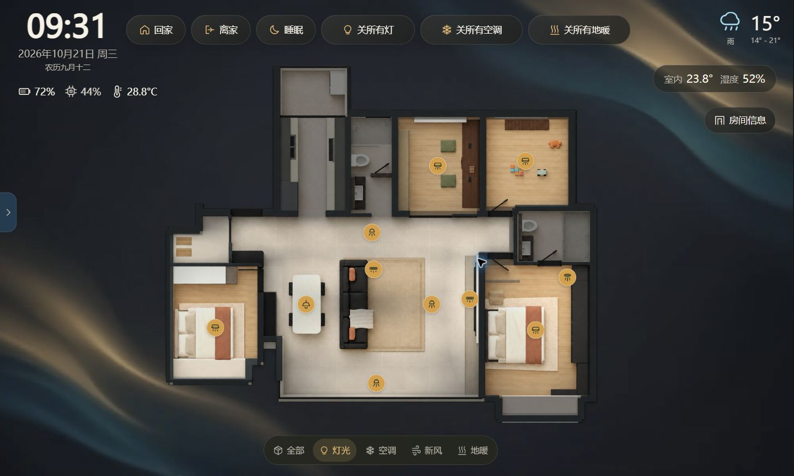

# 暮色居家 · Home Evening Dashboard

把自己的户型放进 Home Assistant：首页看 2D/3D 房子、天气、日历和房间设备，家中概览看摄像头、电费与网络状态。

本项目按技术分享整理，提供能部署的前端、模型源码、可选集成快照和逐步配置说明。先把默认页面打开，再换图片、接设备，不必先学三维建模。

- GitHub：[YyyQq-C/home-evening-dashboard](https://github.com/YyyQq-C/home-evening-dashboard)
- Gitee：[YongQianc/home-evening-dashboard](https://gitee.com/YongQianc/home-evening-dashboard)



图为整理项目时的界面截图。原户型里的灯光、设备和场景按钮仍为模拟，图标变化不代表真实设备动作。

## 先分清两个入口

| 页面 | 用途 | 控制行为 |
| --- | --- | --- |
| `index.html` | 原暮色界面：户型、房间、天气、日历、概览、家电 | 可绑定真实读数；设备、灯光和场景操作仍模拟 |
| `control.html` | 新增独立设备控制页 | 默认只读；配置实体并手动启用 `live` 后，才调用 HA 服务 |

独立控制入口通过离线替身和本地浏览器检查，未执行真实家电动作。原模型按钮未全部接成实控，自己的设备仍需单独验证。

## 按需求找教程

| 想做什么 | 对应说明 |
| --- | --- |
| 从下载开始，第一次显示页面并填一台设备 | [00 · 新手上手与配置示例](docs/00-新手上手与配置示例.md) |
| 查文件位置、仪表盘和配置加载方式 | [01 · 安装和第一次打开](docs/01-安装和第一次打开.md) |
| 灯、空调、地暖、新风和场景怎么实控 | [02 · 真实控制配置](docs/02-真实控制配置.md) |
| 天气、电网、摄像头、平板数据怎么接 | [03 · 数据接入配置](docs/03-数据接入配置.md) |
| 每组源码和工具的作用 | [04 · 文件逐项说明](docs/04-文件逐项说明.md) |
| 换自己的户型、改模型、更新和回退 | [05 · 更换户型和维护](docs/05-更换户型和维护.md) |
| 换背景、固定单图、增加轮换、处理缓存 | [06 · 更换背景图片](docs/06-更换背景图片.md) |
| 查原展示页的读数别名 | [实体映射索引](docs/实体映射索引.md) |
| 查已验证和未验证内容 | [验证与脱敏说明](docs/验证与脱敏说明.md) |
| 查组件和图片来源 | [第三方来源与版本](THIRD_PARTY.md) |

配置说明均提供同名 HTML，离线双击可读。总览是 [离线使用说明.html](离线使用说明.html)。根目录只使用 `README.md` 作为仓库首页，避免 Gitee 误显示 HTML 源码。

## 快速开始：先显示页面

### 1. 下载项目

GitHub 点击 `Code → Download ZIP`；Gitee 从“克隆/下载”下载 ZIP，解压即可。使用 Git 的电脑可以运行下面任意一个命令，仅下载公开源码，不访问 HA 或操作设备：

```sh
git clone https://gitee.com/YongQianc/home-evening-dashboard.git
```

```sh
git clone https://github.com/YyyQq-C/home-evening-dashboard.git
```

现成网页已包含打包的 Three.js、视频和历法依赖。仅部署使用页面，不要求安装 npm、Node.js 或 Python。

### 2. 复制前端目录

找到自己 HA 中包含 `configuration.yaml` 的配置目录，把仓库的 `www/home-evening` 整个复制到其 `www/home-evening` 下：

```text
HA 配置目录/
  configuration.yaml
  www/
    home-evening/
      index.html
      control.html
      site-config.js
      screen.css
      assets/
      ...其他运行文件
```

先只复制前端目录。不要把模型开发源码、集成目录、账号配置、数据库和原始图纸全部复制到 `www`。

### 3. 新建 HA 仪表盘

新建一个可编辑仪表盘，进入编辑及原始配置编辑器，粘贴下面内容，也就是 [configs/dashboard.yaml](configs/dashboard.yaml)。只处理新仪表盘，保留已有配置。

```yaml
title: 暮色居家示例
views:
  - title: 户型展示
    path: home
    type: panel
    cards:
      - type: iframe
        url: /local/home-evening/index.html
  - title: 真实控制
    path: control
    type: panel
    cards:
      - type: iframe
        url: /local/home-evening/control.html
```

保存后应有两个页签。还没填实体也能看默认户型、背景和日历；天气、设备提示未配置或不可用是正常现象。

`/local/` 对应 HA 配置目录里的 `www/`。从 HA 仪表盘打开，页面才能读取父级已有的 HA 会话。直接双击 HTML 或独立打开静态地址不能代替这个宿主。复制静态文件本身不要求重启 HA。

### 4. 先配置一台设备

在 HA“开发者工具 → 状态”复制自己的准确实体 ID，编辑 HA 上的 `site-config.js`，填写 `control.devices`，保持 `control.mode: 'read-only'`。

先核对名称、状态和设备能力，再在原生 HA 中确认能操作。确实需要下发时才改为 `live`，观察一台设备的动作。完整的可复制配置与每一步预期结果见 [新手上手](docs/00-新手上手与配置示例.md)。

原展示页的读数另由 `entities`、`weather.sensors` 配置，不会按房间名称自动匹配。前端不填 HA 密码、长期令牌、天气密钥或摄像头验证码。

## 换背景，最简单怎么做

页面背景与中间户型分开。只换背景，先处理 `www/home-evening/assets` 中这六张图：

| 主题 | 0 号 | 1 号 | 2 号 |
| --- | --- | --- | --- |
| 深色 | `background-night.webp` | `background-night-aurora.webp` | `background-night-interior.webp` |
| 浅色 | `background-day.webp` | `background-day-interior.webp` | `background-day-lineart.webp` |

现有图片和设计画布都是 2000×1200。将自己的图片真正转换为 WebP、保留备份，再同名替换文件；只改 JPG 扩展名不能完成转换。

深浅主题各 3 张图，按小时轮换，同一小时刷新通常不会换图。只替换其中一张，未必马上轮到它。想始终显示同一张，可以复制为该主题的三个文件名。显示设置能切主题，目前没有上传图片控件。

固定单图的 CSS、增加第 4 张背景、六张原图预览，以及路径、裁切、缓存排查，均在 [背景教程](docs/06-更换背景图片.md)。换户型底图另看 [户型教程](docs/05-更换户型和维护.md)，两者不要混用。

## 设备和数据接入路径

| 模块 | 数据链路 | 先确认什么 |
| --- | --- | --- |
| 空调、地暖、新风、灯光 | 品牌集成 → HA 实体 → 页面读数或显式服务调用 | 原生 HA 中先能显示、能操作 |
| 天气 | 和风后端 → 天气与附属传感器、预报订阅 | 地点、单位、实体和预算初始化 |
| 电费 | `state_grid` → 原始实体 → 模板桥接 → 前端卡片 | 先有原始数据，再查桥接属性 |
| 视频 | 摄像头集成 → HA camera 实体 → HLS 播放 | 原生详情先能播放，回放另验证 |
| 日历 | 本地中国历与 lunar-javascript | 不接个人日程和提醒服务 |

已有 HA 实体就不必安装全部后端，也不必更换设备品牌。随附后端为指定版本快照，HA/Python、机型和地区有兼容限制，见 [数据接入](docs/03-数据接入配置.md)。

## 本机预览和检查

有 Python 3 的开发电脑，在仓库根目录运行，提供本机静态预览，用 Ctrl+C 停止；不部署、不连接家电：

```sh
python -m http.server 8793 --bind 127.0.0.1 --directory www
```

打开 `http://127.0.0.1:8793/home-evening/index.html`。适合看背景、布局和日历；没有 HA 宿主，不能据此验证真实数据。

有 Node.js 时可运行离线控制测试，仅在内存中模拟服务：

```sh
node --test tests/control-actions.test.mjs
```

完整源码语法、JSON、默认配置及已知敏感模式检查需要 Python 3.14 和 Node.js。3.14 要求来自视频后端语法，不是网页运行要求：

```sh
python tools/validate_package.py
```

## 更新和排查

- 更新前备份自己的 `site-config.js`、背景和仪表盘配置，不用默认空映射覆盖个人配置。
- 页面空白，先查 `/local/` 路径和文件完整性；直接请求脚本或图片，确认不是 404 或登录页。
- 设备全不可用，先查同源 iframe、准确实体和当前用户权限。
- 模型亮灯但家里没动作，是因为原展示页仍模拟；实控入口是 `control.html`。
- 换图没变化，先确认主题和序号，再处理缓存。项目不注册 Service Worker，额外缓存规则需按自己的环境处理。

项目不含原家庭凭据、原始 DWG、账本和数据库。保留的第三方组件和产品图片不自动获得统一授权，继续分享前请阅读 [THIRD_PARTY.md](THIRD_PARTY.md)。
