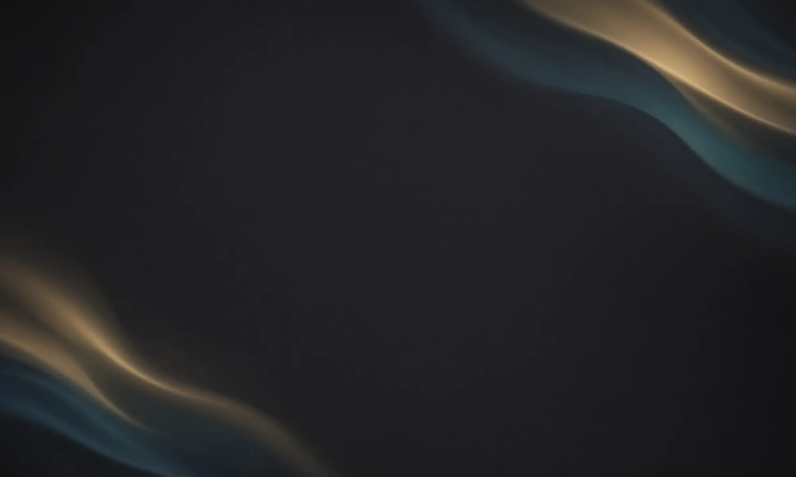
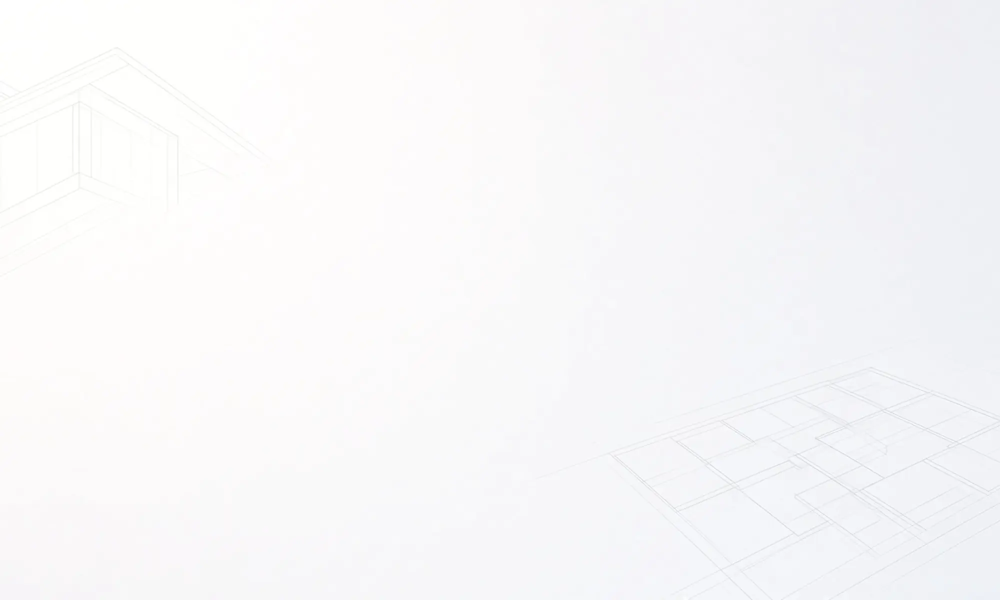

# 更换背景图片

本节针对原暮色展示页 `index.html`。独立设备控制页 `control.html` 使用 `control.css` 的纯色布局，不读取这里的六张背景。

## 先分清背景和户型

| 想改的部分 | 文件或入口 |
| --- | --- |
| 铺满整页的氛围背景 | `www/home-evening/assets/background-*.webp`，本节说明 |
| 中间的 2D 户型 | `assets/floorplan-textured.webp`，还要调整坐标与灯光边界，见 [户型教程](05-更换户型和维护.md) |
| 三维墙体、家具 | `model-source`，见户型教程 |
| 深色、浅色、跟随日出日落 | 页面“显示设置 → 界面外观” |
| 独立控制页配色 | `www/home-evening/control.css` |

页面目前没有上传背景图片的按钮，`site-config.js` 也没有 `background` 配置字段。需要替换图片文件，或按下文修改 CSS。

## 六张背景与轮换顺序

以下路径相对 `www/home-evening/`。现有背景全部为 2000×1200，宽高比 5:3，都是不含户型和按钮的纯背景。

| 主题 | 序号 `data-ambient` | 文件 |
| --- | --- | --- |
| 深色 | 0 | `assets/background-night.webp` |
| 深色 | 1 | `assets/background-night-aurora.webp` |
| 深色 | 2 | `assets/background-night-interior.webp` |
| 浅色 | 0 | `assets/background-day.webp` |
| 浅色 | 1 | `assets/background-day-interior.webp` |
| 浅色 | 2 | `assets/background-day-lineart.webp` |

### 深色组：0、1、2





### 浅色组：0、1、2




## 方法一：保留文件名，直接换图

这是最少改文件的方法，不需要 npm，不需要重建三维模型。

1. 备份 HA 上正在使用的六张背景。备份放本机或其他私有目录，不放公开静态目录。
2. 准备自己的纯背景图，可以用自己的摄影、合法素材或生成图片。不要用带有天气、文字和按钮的整张界面截图，否则页面会叠出两套 UI。
3. 用图片工具真正导出为 WebP。先按 2000×1200 裁切，主体尽量不靠边，注意顶部文字和中间户型的可读性。只把 JPG 扩展名改成 `.webp` 不会转换格式。
4. 按上表改成对应文件名，复制到 HA 的 `www/home-evening/assets/`，覆盖之前确认备份存在。
5. 从 HA 仪表盘重新打开，在显示设置里选对应主题。测试时先固定深色或浅色，避免太阳状态自动切换主题。
6. 按下面的轮换和缓存说明检查结果。只换静态图片不要求重启 HA。

例如换深色极光图，实际文件为：

```text
HA 配置目录/www/home-evening/assets/background-night-aurora.webp
```

在自己当前 HA 地址后追加下面路径，可以直接检查图片：

```text
/local/home-evening/assets/background-night-aurora.webp
```

### 为什么只换一张，打开还没看到

当前实现不是每次刷新随机抽图。`ambient.js` 按设备时间计算：

```js
Math.floor(Date.now() / 3600000) % 3
```

结果是 0、1、2，对应上表。时钟一致的设备，同一小时得到同一序号，刷新通常不会换图。页面可见时约每 10 秒检查一次，跨整点后可能稍等片刻才更新；后台暂停轮询，恢复可见时重新应用。

深浅主题和背景序号是两件事。例如当前序号为 2，浅色用 `background-day-lineart.webp`，深色用 `background-night-interior.webp`。只换了 1 号图，当前显示 2 号就看不到变化。

立即核对可以先直接打开图片 URL，再用浏览器开发者工具检查 `#screen` 的 `data-theme`、`data-ambient`。下面语句只读取当前页面，不操作设备；需要在 iframe 对应的控制台上下文执行：

```js
document.querySelector('#screen')?.dataset
getComputedStyle(document.querySelector('#screen')).getPropertyValue('--ambient-image')
```

## 方法二：固定一张背景

### 不改代码：复制为三个文件名

把同一张深色图复制成深色组的三个文件名，把同一张浅色图复制成浅色组的三个文件名。序号仍轮换，看到的图片相同。

深浅主题也想共用一张图，就复制成全部六个文件名。但主题的文字、面板和渐变遮罩仍会改变，不会因为图片相同就完全一样。

### 保留自己的文件名：追加 CSS

将自己的两张图放到 `assets/my-dark.webp`、`assets/my-light.webp`，再把下面规则追加到 `www/home-evening/screen.css` 末尾。文件名为示例，要与实际文件对应。

```css
/* 固定深色背景，覆盖原轮换规则。 */
.screen {
  --ambient-image: url('./assets/my-dark.webp') !important;
}

/* 浅色主题使用自己的浅色图。 */
.screen[data-theme=light] {
  --ambient-image: url('./assets/my-light.webp') !important;
}
```

这里的 `!important` 用于覆盖原先包含 `data-ambient` 的普通选择器。只普通地改 `.screen` 里的一个变量，可能会被 1/2 号规则覆盖。两条都保留，浅色写在后面。

恢复轮换时删掉自己追加的规则。继续增加轮换图之前也先移除，否则新规则依旧会被固定图覆盖。

## 方法三：增加为四张轮换图

这是源码调整，先备份 `settings.js`、`screen.css`。当前深浅两组共用一个序号和数量，扩展时两组一起补齐。

1. 添加 `assets/background-night-custom.webp`、`assets/background-day-custom.webp`。
2. 在 `screen.css` 末尾追加下列规则。序号从 0 开始，第 4 张是 3。

```css
/* 深色第 4 张。 */
.screen[data-ambient="3"] {
  --ambient-image: url('./assets/background-night-custom.webp');
}

/* 浅色第 4 张。 */
.screen[data-theme=light][data-ambient="3"] {
  --ambient-image: url('./assets/background-day-custom.webp');
}
```

3. 打开 `settings.js`，搜索 `ambientIndex(Date.now(),3)`。当前有两处：`apply()` 中的序号计算，以及末尾可见轮询中的比较。两处都改为 `ambientIndex(Date.now(),4)`；只改一处会造成比较和应用不一致。
4. `ambient.js` 接受数量参数，不需要修改。刷新后核对 0、1、2、3 均有图，再分别检查深浅主题。

只给深色加到四张、浅色仍保留三张，还需要进一步按主题选择数量。本节给出的是两组统一四张的做法。

## 裁切、颜色与图片大小

`screen.css` 在 `.screen:before` 上使用 `background-size: cover`、`background-position: center`，并叠加 `--ambient-wash` 渐变。设计画布为 2000×1200，页面整体缩放适配屏幕。

图片比例不同，`cover` 铺满时会裁掉边缘。优先在图片工具中按 5:3 裁切。改成 `contain` 可能产生留白，不能直接理解成适配完成。背景不要放必须完整显示的文字、二维码或关键细节。

界面里还有主题遮罩和面板，所以效果与直接打开原图不同。需要修改遮罩时搜索 `--ambient-wash`，分别处理深浅规则；不要为了换背景删掉整个 `.screen:before`，它负责背景绘制。

不要直接上传数十 MB 的原始照片；先做压缩，再在自己的平板上检查清晰度、加载和内存表现。现有文件大小不代表任何设备都流畅的保证。

## 没有生效，按顺序查

| 现象或原因 | 检查方法 |
| --- | --- |
| 改了电脑里的另一份 | 确认是 HA 正在提供的 `www/home-evening` |
| 路径或图片错误 | 直接打开 `/local/home-evening/assets/文件名.webp`，确认正常显示 |
| 大小写不同 | HA 常运行于区分大小写的系统，名称与 CSS 必须一致 |
| 轮换未到这张 | 检查 `data-ambient`，不停刷新不会重新随机抽取 |
| 主题不对 | 暂时在显示设置里固定主题，查对应组 |
| 固定样式覆盖轮换 | 检查是否保留了方法二的 `!important` 规则 |
| 图片缓存 | 在图片 URL 后临时加 `?v=bg-2` 看返回结果；或开发者工具禁用缓存后重载 |
| 页面仍请求旧 URL | 给对应 CSS 图片路径加版本，如 `url('./assets/background-night.webp?v=bg-2')`，再重新加载更新后的 CSS |
| CSS 本身旧了 | 查看 Network 中实际返回的 `screen.css`；必要时把 `index.html` 的样式链接改为 `./screen.css?v=bg-2` |
| 额外缓存 | 检查自己的反代、Service Worker、WebView；本项目不注册 Service Worker |

只改 iframe 的 HTML 地址版本参数，不等于所有模块、CSS 和图片都能刷新。先检查实际返回文件，不要反复重启 HA 或真实设备。

## 完成后验收和回退

1. 直接打开每张改过的图片，确认格式、方向和内容。
2. 在 HA iframe 中切深浅主题，确认文字、天气、户型和按钮清晰。
3. 轮换方案检查全部序号；固定方案确认跨小时仍是同一张图。
4. 在实际平板检查裁切、清晰度和加载。
5. 不满意就恢复备份图片；改过 CSS/JS 的也一起恢复，再处理缓存。

验证外观不需要开灯、调温或执行场景。
