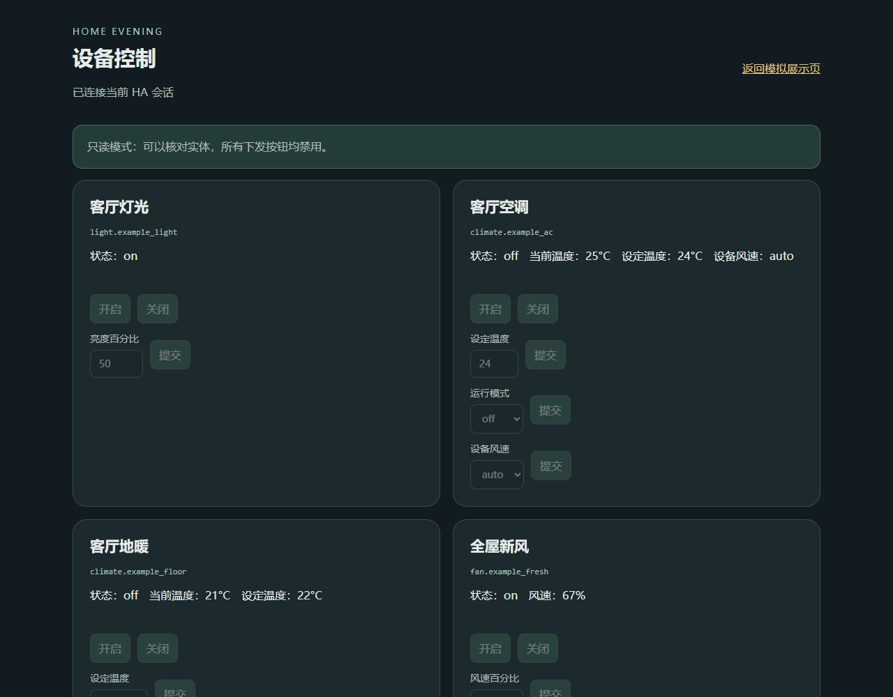
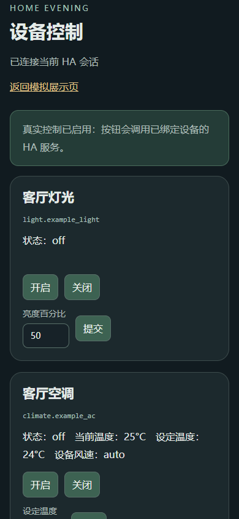

# 验证与脱敏说明

核对日期：2026 年 10 月 21 日。本项目提供可部署前端、模型源码、集成快照和配置示例。本次代码尚未实际部署到 HA；验证范围见下文。

## 做了什么

将现有暮色页提取为可复制的静态目录，移除原家庭端点、摄像头序列号、户号、硬件 ID、发布记录和自动登录部署脚本；原实体读取改成中性别名；补充独立的真实控制入口，默认只读。

后端程序使用白名单收集，只包含程序、清单和翻译；没有配置项、密钥、原厂数据库、运行日志、实际预算、媒体缓存或录像。示例户型几何和已在文章中展示的静态效果保留，原始 DWG、住址文件名和实景照片不包含。

## 环境与检查

Browser 插件及其 browser 技能未列在本会话中，分类为 `Browser plugin not available`。按界面测试技能使用既有 Playwright 和 Edge，在本机静态服务器及 HA 测试替身中检查，没有安装新的浏览器依赖。

交互路径为：本地 HA 替身宿主 → 只读控制页 → 检查按钮禁用和零下发 → 明确切换测试配置为 live → 单个灯光、温度、空调风速和新风百分比提交 → 检查目标与参数 → 模拟状态回读 → 手机视口 → 原暮色展示页打开日历。

| 检查 | 结果 |
| --- | --- |
| 21 项 Node 离线控制测试 | 通过 |
| 只读模式不调用 HA 服务 | 通过；测试替身记录为零 |
| 单灯关闭目标隔离 | 通过；只命中配置的单个灯实体 |
| 调温不额外发送开关和模式 | 通过 |
| 空调、新风的能力及数值校验 | 通过 |
| 设备缺失、离线、断线拒绝操作 | 通过 |
| 同设备待响应时重复提交拦截 | 通过 |
| 超时保留结果未知，不乐观修改实体 | 通过 |
| 供应商原始异常不外泄到新入口日志 | 通过 |
| 页面身份、有效内容和无错误覆盖层 | 通过 |
| 本地浏览器交互中的页面脚本异常 | 0 |
| 温度和选择项草稿在轮询中保留 | 通过 |
| 清空数值后提交不会被转成零下发 | 通过 |
| 1280×1000 桌面与 390×844 手机视口 | 通过；手机无横向页面溢出 |
| 原展示页独立加载与日历打开 | 通过 |
| 预算生成器月份、次数、拒绝覆盖等 5 项检查 | 通过 |
| 国网桥接模板生成 | 通过；仅生成本地模板，不取数 |

完整语法检查用 Python 3.14 解析随包后端，用 Node.js 检查前端模块；JSON 文件和必要入口也进行了检查。`tools/validate_package.py` 可复现这些检查。它不是完整 HA 集成测试，不能替代安装与设备验证。



图：本地 HA 替身，全部数值和实体均为示例。只读模式不会提交。



图：手机视口下的新增控制入口；显示的是测试替身的状态，不是作者家中的设备。

## 如何复现本地测试

在本包根目录，用已安装 Node.js 的开发终端运行：

```sh
node --test tests/control-actions.test.mjs
```

它只在内存中模拟 HA。完整源码和已知敏感模式检查需要 Python 3.14 及 Node.js：

```sh
python tools/validate_package.py
```

这两个命令不部署、不调用 HA 服务、不连接实际家电。自己填写实体以后，不要再把配置公开打包；原文件摘要变化属于正常配置行为，先对比自己修改的文件。

## 本次没有证明的事情

- 未在真实 HA 中安装本次新增控制入口，未实际执行开关、调温、风速或场景。
- 未在新环境完整安装或迁移全部后端集成，未验证各品牌硬件和固件兼容性。
- 未重新验证供应商登录、国网取数、视频流、SD 回放与声音。
- 未验证真实平板的 WebView、触摸、GPU、内存及长时间运行。
- 未把原三维模型、2D 图标和所有房间按钮改成真实控制；它们仍有明确的模拟标记。
- 第三方电费前端附件的准确原帖链接和独立授权资料未完整记录，来源说明保留这一点，没有编造授权。

本包能复用的是页面、配置结构、控制适配和已明确范围的代码快照；用户仍要在自己的环境核对实体和实际设备行为。
