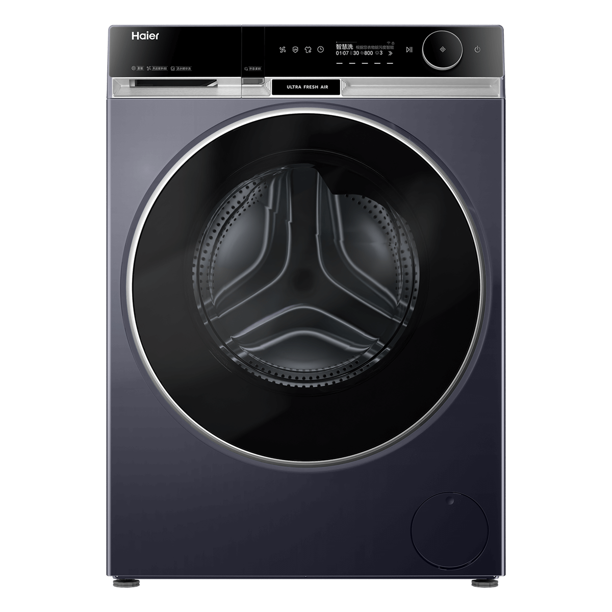
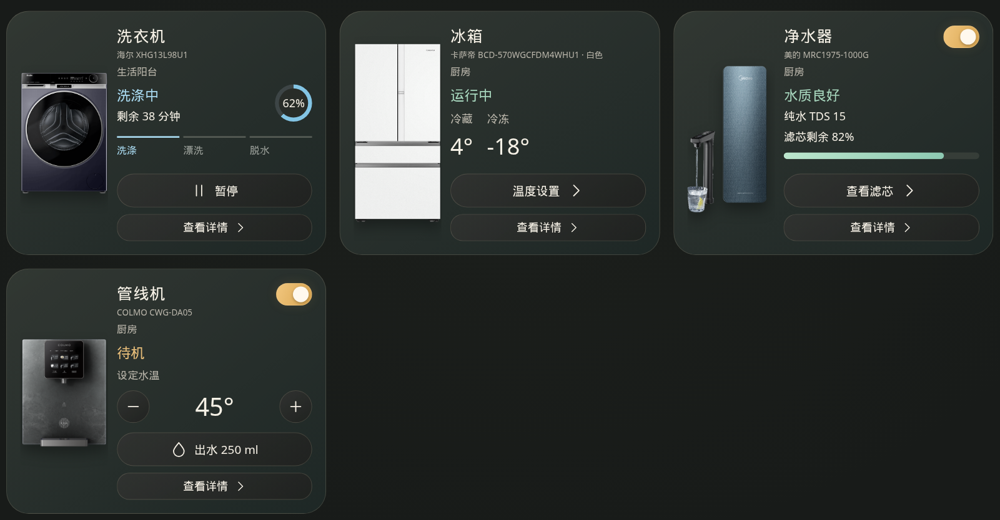
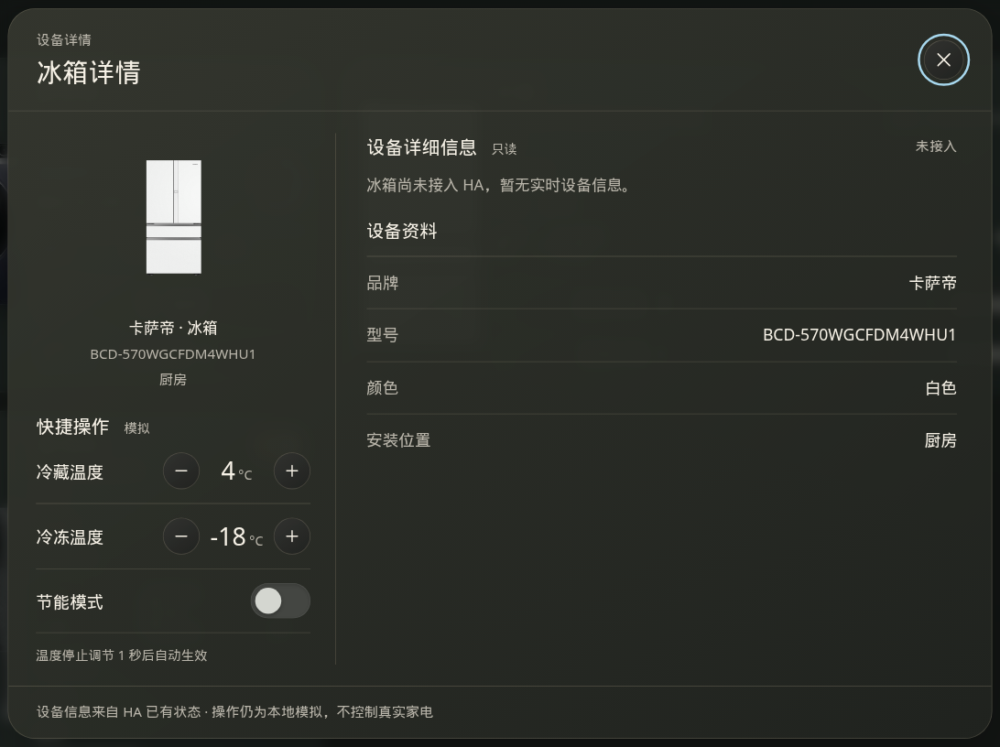

# 家电卡片

一套可以单独复制走的家电卡片和设备详情样式。样式、示例页、产品图和截图都在这个目录里。普通静态网页或其他前端项目直接引用即可，不需要 Home Assistant。

## 怎么用这套样式

1. 把整个 `appliance-cards` 文件夹复制到你的项目里。页面、样式和 `assets/` 要留在同一份目录中。
2. 在你的 HTML 里用相对路径引入样式。页面和 `appliance-cards.css` 放在一起时：

```html
<link rel="stylesheet" href="./appliance-cards.css">
```

3. 卡片和详情弹窗的标记、类名从 `index.html` 抄。产品图用本目录的相对路径，例如 `./assets/washer.png`。
4. 外层用一块 `.screen` 画布，并写上 `data-theme` 和 `data-appliance-columns`。

```html
<html lang="zh-CN" data-theme="dark">
<body>
  <div class="screen" data-theme="dark" data-appliance-columns="3">
    <section class="page appliance-page">
      <div class="appliance-grid">
        <section class="appliance-card" data-appliance="washer">
          <div class="appliance-visual"></div>
          <div class="appliance-copy">
            <h2>洗衣机</h2>
            <p class="product-model">型号</p>
            <p class="location">生活阳台</p>
            <!-- 状态、操作按钮、查看详情，完整结构见 index.html -->
          </div>
        </section>
      </div>
    </section>
  </div>
</body>
</html>
```

页面不在这个文件夹里时，把上面的 `./` 改成指向 `appliance-cards.css` 和 `assets/` 的相对路径，例如 `./appliance-cards/appliance-cards.css`。

- `data-theme` 取 `dark` 或 `light`。浅色时，`<html>` 和 `.screen` 都要写成 `light`。浅色变量定义在 `html[data-theme=light]` 上。
- `data-appliance-columns` 取 `2`、`3` 或 `4`。2 列是横排大卡，3 列是紧凑横排，4 列把产品图放在文字上面。
- `.screen` 按 2000×1200 排版。示例页会按窗口宽高把它 `scale()` 进可视区域。嵌到自己的页面时，给这块画布留出 2000×1200，或用同样的比例缩放。
- 换成自己的图片时，只改 ``，继续用相对路径。
- 按钮和开关只改变页面上的文字和状态。样式表本身不请求接口，也不控制设备。交互可以照 `index.html` 里的脚本改，也可以换成你自己的。

## 界面

默认是深色、每行 3 张。第一行是洗衣机、冰箱、净水器，管线机在第二行。



点卡片上的「查看详情」打开设备详情。左侧是产品图和模拟操作，右侧是只读资料。



## 本机预览

在仓库的 `www` 目录启动静态服务：

```sh
cd www
python3 -m http.server 8765
```

浏览器打开 <http://127.0.0.1:8765/appliance-cards/index.html>。

顶栏可以切换每行 2、3、4 张，以及深色和浅色。筛选有「全部」「厨房」「洗护」。

直接双击 `index.html` 时，部分浏览器会拦截本地图片。用上面的静态服务打开即可。

## 文件

| 文件 | 作用 |
| --- | --- |
| `appliance-cards.css` | 卡片、详情弹窗、列数和深浅色 |
| `index.html` | 可切换列数、主题和筛选的示例页，标记可以照着抄 |
| `assets/` | 洗衣机、冰箱、净水器、管线机产品图 |
| `docs/` | 上面两张界面截图 |

## 可选：放到 Home Assistant

只有想把示例页挂在 Home Assistant 里时才需要这一步。把整个 `appliance-cards` 目录复制到配置目录的 `www` 下，然后访问：

```text
http://homeassistant.local:8123/local/appliance-cards/index.html
```

地址里是 `/local/`，不是 `/www/`。普通网页不用这段地址，按上面的相对路径引用即可。
